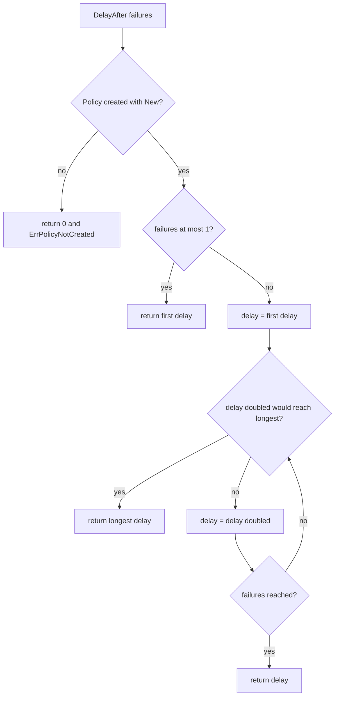
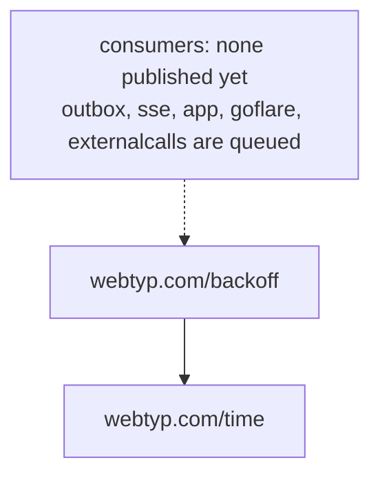

> Read AGENTS.md at the repo root before any change.
> **Finish by yourself:** when the delivery check passes, commit, push and open the pull request. Never ask whether to
> proceed or finalize — nobody answers, and a session that waits ends without your work. Commit after every stage.
> Never run `git reset`, `git restore`, `git checkout -- <file>` or `git stash` on your own work.
> A PR that does not compile, or whose tests could not run, is a failed delivery. Stuck for 30 minutes: open the PR anyway and list what fails.

# Plan: `backoff`

The repo today holds the stub `gonew` wrote (`backoff.go` with an empty `Backoff` struct). This plan replaces it with the one place in the ecosystem that computes «how long until the next retry».

## Ecosystem search

Searched `grep -rni backoff --include=*.go` over `webtyp` and `veltylabs`, and `ls webtyp | grep -i -E "backoff|retry"`.

| Where | What it does | Decision |
|---|---|---|
| `webtyp/outbox` `outbox.go:236-255` | `minBackoff` 1 s, `maxBackoff` 60 s, `backoff(attempts)`: doubles, capped | **extend**: becomes the first consumer (a separate plan against `outbox`, after this tag is published) |
| `webtyp/sse` `client_config.go` | `RetryInterval`, `MaxRetryDelay` in ms, exponential, browser only | **extend**: later plan against `sse` |
| `webtyp/app` `ssr_loader.go:227-277` | local `backoff` variable, 200 ms doubling to 3 s, `time.Sleep` | **extend**: later plan against `app` |
| `webtyp/goflare` `cloudflare.go:622` | `retry(n, base, fn)` with `base << i` | **extend**: later plan against `goflare` |
| `webtyp/idempotency` | server side of the `Idempotency-Key` header (inbound requests) | **not related**: another concern |

**New**, because none of the four copies is importable by the others: each is private to its repo. This plan deletes nothing here; it creates the one path. The four copies die in their own repos, each in one plan that imports `webtyp.com/backoff` (queued after this tag).

## Design gate

**1. Prior art** (links **unverified**: not read in this session; the executor must not rely on them):
- `github.com/cenkalti/backoff` — `ExponentialBackOff` with initial interval, multiplier, max interval, jitter. Unverified.
- gRPC connection backoff — https://github.com/grpc/grpc/blob/master/doc/connection-backoff.md — base delay, multiplier, jitter, max delay. Unverified.
- AWS «Exponential Backoff And Jitter» (Architecture Blog) — recommends jitter against thundering herds. Unverified.

They share: a first delay, a multiplier, a cap. This library keeps those three (multiplier fixed at 2, the value all three default to) and **departs** by having no jitter and no `Sleep`/`Retry` loop: the callers of this ecosystem retry one record at a time (one tab in `outbox`, one executor in `externalcalls`), so a herd does not form, and a random source does not exist in the WASM subset (`webtyp/time`, no `math/rand`).

**2. Novice-name test.** `backoff.New(first, longest)` → «a backoff policy: first wait, longest wait». `policy.DelayAfter(3)` → «the delay after 3 failures». `backoff.Policy`, `ErrFirstDelayNotPositive`, `ErrLongestBelowFirst`, `ErrPolicyNotCreated` each read as a sentence. The package name is the word every Go developer already knows.

**3. Complexity ledger.**
```
Concepts the developer must learn   +3 (Policy, New, DelayAfter)
Files they must touch to do X       −1 per consumer (no private backoff function to write)
Lines at the call site              −12 per consumer (a private loop becomes one call)
Ways to do the same thing           +1 now (a fifth copy exists beside four) → −4 when the four consumer plans land; those plans are queued, not optional
```

**4. Where it belongs.** One concern, its own repo, imports only `webtyp.com/time`; runs in the browser and on the server. No second implementation, so no conformance suite.

**5. What it deletes.** Nothing in this repo (new capability). The consumer plans delete `outbox.go:236-255`, the `ssr_loader.go` local variable, `goflare` `retry` and the `sse` ms fields.

## Tools

```bash
go install webtyp.com/devflow/cmd/gotest@latest
go get webtyp.com/time@v0.6.4
```

Environment: `GOPRIVATE=webtyp.com/*,github.com/veltylabs/*`, `GOFLAGS=-mod=mod`; run `go mod tidy` after `go get`.

## APIs used

| symbol | exact signature | tag | file |
|---|---|---|---|
| `time.Nano` | `type Nano int64` (nanoseconds) | `webtyp.com/time v0.6.4` | `time/api.go:11` |

There is no `Second` constant in `webtyp.com/time`: write `const second time.Nano = 1000000000` in the test file. If a signature in the published tag differs from this table, stop and name the symbol in the PR; never adapt it by guessing.

## Stage 1 — diagrams, tests (red) and `docs/TESTS.md`

Files: `docs/diagrams/DELAY_FLOW.md`, `docs/diagrams/PLACEMENT.md`, `tests/backoff_test.go`, `docs/TESTS.md`.

`docs/diagrams/DELAY_FLOW.md` — three parts (context header: «what `DelayAfter` answers after a failed attempt; verified by `tests/backoff_test.go`», then this diagram, then a numbered walkthrough of every node):



`docs/diagrams/PLACEMENT.md` — context header, then:


and a walkthrough saying: runs in the browser and on the server, imports only `webtyp.com/time`, and nobody imports it yet.

`tests/backoff_test.go` (package `tests`, external to the library). Each test is setup → call → expected; `p` is `backoff.New(second, 60*second)` unless the row says otherwise:

```go
package tests

import (
	"testing"

	"webtyp.com/backoff"
	"webtyp.com/time"
)

const second time.Nano = 1000000000

func newPolicy(t *testing.T, first, longest time.Nano) backoff.Policy {
	t.Helper()
	p, err := backoff.New(first, longest)
	if err != nil {
		t.Fatalf("New(%d, %d): %v", first, longest, err)
	}
	return p
}

func wantDelay(t *testing.T, p backoff.Policy, failures int64, want time.Nano) {
	t.Helper()
	got, err := p.DelayAfter(failures)
	if err != nil {
		t.Fatalf("DelayAfter(%d): %v", failures, err)
	}
	if got != want {
		t.Fatalf("DelayAfter(%d) = %d, want %d", failures, got, want)
	}
}
```

| Test | setup → call → expected |
|---|---|
| `TestPolicy_FirstFailureWaitsFirstDelay` | `New(1s, 60s)` → `DelayAfter(1)` → `1s` |
| `TestPolicy_DoublesAfterEachFailure` | `New(1s, 60s)` → `DelayAfter(1..6)` → `1s, 2s, 4s, 8s, 16s, 32s` |
| `TestPolicy_NeverExceedsLongest` | `New(1s, 60s)` → `DelayAfter(7)`, `DelayAfter(8)`, `DelayAfter(100)` → `60s` each |
| `TestPolicy_HugeFailureCountDoesNotOverflow` | `New(1s, 60s)` → `DelayAfter(63)`, `(64)`, `(65)`, `(9223372036854775807)` → `60s` each |
| `TestPolicy_ZeroOrNegativeFailuresWaitFirstDelay` | `New(1s, 60s)` → `DelayAfter(0)`, `DelayAfter(-5)` → `1s` each |
| `TestPolicy_FirstEqualsLongestNeverGrows` | `New(5s, 5s)` → `DelayAfter(1)`, `(2)`, `(10)` → `5s` each |
| `TestPolicy_LongestNotMultipleOfFirst` | `New(3s, 10s)` → `DelayAfter(1..4)` → `3s, 6s, 10s, 10s` |
| `TestNew_RejectsNonPositiveFirst` | `New(0, 60s)` and `New(-1, 60s)` → `err == backoff.ErrFirstDelayNotPositive` and a zero `Policy` |
| `TestNew_RejectsLongestBelowFirst` | `New(2s, 1s)` → `err == backoff.ErrLongestBelowFirst` |
| `TestPolicy_ZeroValueIsRejected` | `backoff.Policy{}` → `DelayAfter(1)` → `0` and `err == backoff.ErrPolicyNotCreated` |

(`==` between the error and the constant is fine in a test: tests run on the stdlib toolchain, never in WASM.)

`docs/TESTS.md`: a table with columns `Test | File | Rule it proves`, one row per test above, file `tests/backoff_test.go`.

Commit. The tests do not compile yet: that is expected at the end of this stage.

## Stage 2 — `backoff.go`

Replace the whole content of `backoff.go` (delete the `Backoff` struct and the old `New() *Backoff`) with:

```go
// Package backoff says how long to wait before the next retry: the delay
// doubles after each failure, from a first delay up to a longest delay.
//
// It never sleeps, never retries and never reads a clock; the caller does.
//
//	policy, err := backoff.New(1000000000, 60000000000) // 1 s first, 60 s longest
//	if err != nil { return err }
//	wait, err := policy.DelayAfter(3) // 4 s: the delay after 3 failures
//
// Flow: https://github.com/webtyp/backoff/blob/main/docs/diagrams/DELAY_FLOW.md
package backoff

import "webtyp.com/time"

// backoffError is the concrete type of this package's errors. Compare with
// ==, never errors.Is: == between two error values is fine on the stdlib
// toolchain and the constants are the only values this package returns.
type backoffError string

func (e backoffError) Error() string { return string(e) }

const (
	// ErrFirstDelayNotPositive: New received a first delay of zero or less.
	ErrFirstDelayNotPositive backoffError = "backoff: the first delay must be greater than zero, so no policy was created and nothing was waited or retried. Pass a first delay such as 1000000000 (one second) to backoff.New."

	// ErrLongestBelowFirst: New received a longest delay smaller than the first.
	ErrLongestBelowFirst backoffError = "backoff: the longest delay is smaller than the first delay, so no policy was created and nothing was waited or retried. Pass a longest delay equal to or greater than the first delay to backoff.New."

	// ErrPolicyNotCreated: DelayAfter was called on a Policy that did not come from New.
	ErrPolicyNotCreated backoffError = "backoff: this policy was not created with backoff.New, so it has no delays and nothing was waited. Create it with backoff.New(first, longest) and call DelayAfter on the result."
)

// Policy holds the first and the longest delay. Only New creates a valid one;
// the zero Policy answers ErrPolicyNotCreated.
type Policy struct {
	first   time.Nano
	longest time.Nano
}

// New creates a Policy. first must be greater than zero and longest must be at
// least first.
//
// Example: policy, err := backoff.New(1000000000, 60000000000)
func New(first, longest time.Nano) (Policy, error) {
	if first <= 0 {
		return Policy{}, ErrFirstDelayNotPositive
	}
	if longest < first {
		return Policy{}, ErrLongestBelowFirst
	}
	return Policy{first: first, longest: longest}, nil
}

// DelayAfter answers how long to wait after the given number of failed
// attempts: the first delay after 1 failure (and after 0 or a negative count),
// then doubling after each further failure, never more than the longest delay.
//
// Example: wait, err := policy.DelayAfter(3) // first delay of 1 s → 4 s
func (p Policy) DelayAfter(failures int64) (time.Nano, error) {
	if p.first <= 0 {
		return 0, ErrPolicyNotCreated
	}
	delay := p.first
	for step := int64(1); step < failures; step++ {
		// delay*2 >= longest, written without multiplying so it cannot overflow
		if delay >= p.longest-delay {
			return p.longest, nil
		}
		delay *= 2
	}
	return delay, nil
}
```

Do not change the loop: the condition `delay >= p.longest-delay` is the overflow guard (`longest-delay` never overflows because `delay <= longest`), and the loop ends within 63 iterations because the delay doubles each time, whatever `failures` is.

Run `go mod tidy`; `go.mod` must require `webtyp.com/time v0.6.4` and nothing else. Run `gotest`: every test of Stage 1 passes. Commit.

## Stage 3 — documentation

Files: `README.md` (replace the gonew stub), `docs/ARCHITECTURE.md`. English (`webtyp/*`), no client names; use `example.com`/`acme` if a domain is needed.

`README.md` ≤ 150 lines, four sections in this order:
1. `## Why This Exists` — a paragraph (a retry loop that waits a fixed 1 s hammers a service that is down; one that doubles without a cap waits an hour), a **Without this vs. With this** comparison, and the first mention of `webtyp.com/time` and of the delay flow linked inline ([DELAY_FLOW.md](docs/diagrams/DELAY_FLOW.md)).
2. `## Before You Start` — `go get webtyp.com/backoff@v0.1.0`; nothing else.
3. `## Step-by-Step Guide` — Step 1: create the policy; Step 2: compute the delay after each failure; Step 3: what the two errors mean. Each with Goal, a complete compilable `main` (imports `"webtyp.com/fmt"`, never stdlib `fmt`; on error `fmt.Println(err); return`), and the expected output (`1s`, `2s`, `4s` shown as nanosecond numbers: `1000000000`, `2000000000`, `4000000000`). Link `backoff.go` for the errors; do not copy them.
4. `## Documentation Map` — table `Order | Document | What question it answers & when to read it` with `docs/ARCHITECTURE.md`, `docs/diagrams/DELAY_FLOW.md`, `docs/diagrams/PLACEMENT.md`, `docs/TESTS.md`.

`docs/ARCHITECTURE.md`, four sections in this order, no implementation code blocks:
`## 1. Overview in One Minute` · `## 2. Repository Pieces & On-Disk Layout` (table: `backoff.go`, `tests/backoff_test.go`, `docs/…`, each with one responsibility) · `## 3. Step-by-Step Flows` (one subsection, «delay after a failure», happy path and the three error paths, linking `docs/diagrams/DELAY_FLOW.md`) · `## 4. Security Boundaries & Contracts` (why a zero `Policy` is rejected, why no jitter, why no `Sleep`, why no stdlib import).

Permanent docs never link `docs/PLAN.md`. Commit.

## Delivery check

1. `gotest` — builds, vets and runs every test; all pass.
2. `grep -rn "any\b\|interface{}" backoff.go` → empty. `grep -n '"time"\|"math"\|"fmt"\|"errors"' backoff.go` → empty.
3. `grep -rn "Backoff struct\|func New() \*Backoff" .` → empty (the stub is gone).
4. `grep -rn "PLAN.md" README.md docs/ARCHITECTURE.md docs/diagrams` → empty.
5. `git diff --stat main` lists exactly: `backoff.go`, `go.mod`, `go.sum`, `README.md`, `docs/ARCHITECTURE.md`, `docs/TESTS.md`, `docs/diagrams/DELAY_FLOW.md`, `docs/diagrams/PLACEMENT.md`, `tests/backoff_test.go`.

## Stages

| # | Stage | Files |
|---|---|---|
| 1 | diagrams, red tests, `TESTS.md` | `docs/diagrams/*.md`, `tests/backoff_test.go`, `docs/TESTS.md` |
| 2 | the code | `backoff.go`, `go.mod`, `go.sum` |
| 3 | documentation | `README.md`, `docs/ARCHITECTURE.md` |
