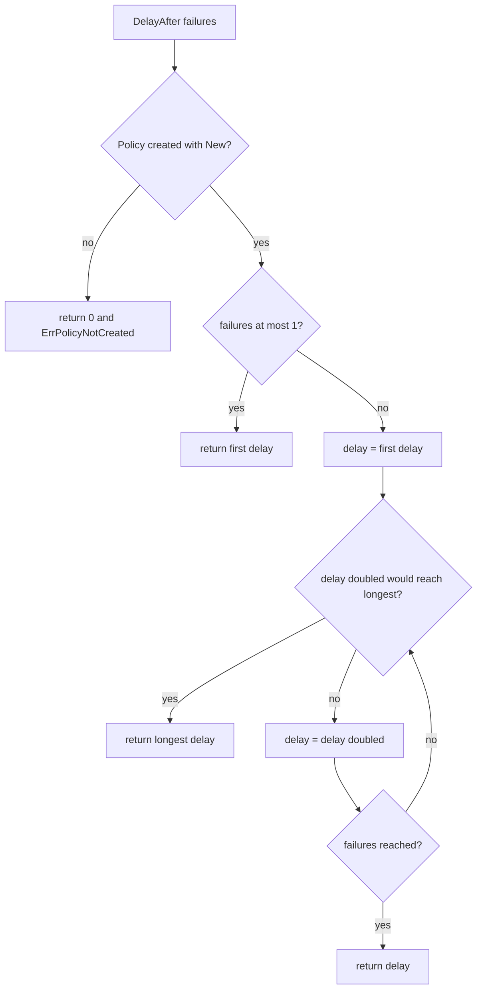

what `DelayAfter` answers after a failed attempt; verified by `tests/backoff_test.go`

1. **DelayAfter failures**: The caller passes how many failures have happened so far.
2. **Policy created with New?**: The policy must be valid.
3. **return 0 and ErrPolicyNotCreated**: The zero value of the policy struct is invalid.
4. **failures at most 1?**: The very first failure, or a negative count, returns the first delay.
5. **return first delay**: Answer the minimum wait time.
6. **delay = first delay**: Start from the first delay to double iteratively.
7. **delay doubled would reach longest?**: If we double now, would we exceed or hit the longest delay cap?
8. **return longest delay**: Return the maximum possible delay.
9. **delay = delay doubled**: Multiply the delay by 2.
10. **failures reached?**: Did we iterate up to the passed failure count?
11. **return delay**: Return the calculated delay.
